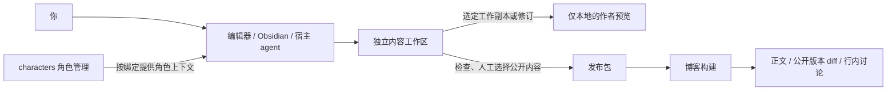

# 独立内容工作区与作品修订设计

> 2026-11-05 更新：本文保留为早期文件工作区设计。最新 [本地优先设计](../../folio/docs/serverless-content-service-design.md) 与 [实现计划](../../folio/docs/serverless-content-service-plan.md) 保留本地 Markdown 编辑，新增 SQLite 历史、离线队列、多设备冲突处理，以及 Vercel 云同步/发布。云端不取代本地写作，Git 非必需。当前文件管线尚未切换。

状态：提案，待讨论。日期：2026-10-29。

本轮只记录设计与迁移计划，不修改应用代码、内容 schema、现有文章或部署配置，不创建工作区或执行迁移。文中的目录、数据字段、操作名称和路由都是拟议契约，不代表已有功能。

## 1. 目标与选择

内容独立于博客代码维护。你和角色继续使用编辑器、Obsidian 或宿主 agent 写作；博客读取明确选择的内容版本，提供正文、共同署名、公开修订和行内讨论的阅读体验。

工作区先采用普通目录与 Markdown，不要求 Git。Git 可以负责备份与同步，也可以换成其他存储；作品身份、修订与评论不能依赖 Git commit、分支名或平台账号。后续接入 CMS 时，复用同一套内容契约和发布流程。

推荐的第一版边界：

- 独立工作区保存可编辑正文、素材、修订快照和讨论。
- 写作工具通过明确的保存、记录版本、提交建议、审核和发布动作管理变化，不另造 agent 聊天系统。
- 博客开发默认读已发布快照；作者预览单独选稿件。
- 正式部署只消费经过检查的发布包，不连接私人工作区。
- 修改记录与评论可选择公开。私人草稿和讨论不随正文自动发布。
- 角色 Profile 保持简洁介绍；共同署名、一作／二作继续属于具体作品。

## 2. 当前项目约束

起草时读取本地工作树得到以下盘点，实施前需要重新核对。

| 内容          | Markdown 文件数 | 当前需要保留的关系                             |
| ------------- | --------------: | ---------------------------------------------- |
| 根目录页面    |               6 | about 与 about-this-site 的语言版本及路径      |
| blog/articles |              28 | slug、kind、语言版本、共同署名、概念与反向链接 |
| blog/columns  |               4 | 章节顺序、计划章节、articleSlug                |
| concepts      |              19 | 概念关系、别名、成熟度、文章引用               |
| entities      |               4 | 实体关系、别名、外链                           |
| projects      |               3 | 项目状态、仓库与概念关系                       |
| gallery       |              21 | 图片、视频、相机信息、语言版本                 |
| 合计          |              85 | 文件数包含翻译，不能当作独立作品数             |

现有约束来自 `content.config.ts`、`nuxt.config.ts`、`utils/contentArticles.ts`、`utils/rubyHook.ts`、共同署名与相册工作流文档：

- Markdown 本身就是 Obsidian vault；保留 wiki 链接、ruby/MDC、数学公式、代码块和现有文件路径。
- 现有查询按 slug 聚合语言版本；迁移不能让多语文章重复、改变回退语言或丢失署名。
- `state`、`status` 已分别表示概念成熟度、实体／项目／专栏状态，不能复用为稿件发布状态。
- 当前文章 schema 要求 `published`，也没有统一的草稿隔离机制。新稿件模型需要在导出环节适配，不能仅添加一个 `draft: true` 就认为隔离完成。
- Nuxt Studio 当前指向 blog 仓库，并禁用直接写工作树的开发模式。外部工作区接入不能假定 Studio 自动跟随；旧编辑入口需要停用写入或另行适配，不能形成两个内容真源。
- 相册媒体已有公开衍生文件与私人原件的边界，迁移沿用，不把原始照片随快照一起公开。
- 仓库提供 build、generate、preview 命令；当前托管环境和部署触发器仍需实施前核对，不能把某个平台当成已确认前提。

## 3. 职责与目录



推荐位置示例为 `D:/projects/kotolog-content`，可由用户选择。所有工具显式解析工作区路径，不扫描 HOME，不要求目录与博客同父级，也不修改全局 agent 记忆。

```text
kotolog-content/
  workspace.json                  工作区 ID 与格式版本
  content/                        可直接编辑、供 Obsidian 打开的正文
    about.md
    blog/articles/...
    blog/columns/...
    concepts/...
    entities/...
    projects/...
    gallery/...
  assets/                         可供作品引用的素材与公开衍生资源
  private-originals/              可选私人原件，永不作为默认导出输入
  .workspace/
    documents/                    文件与稳定身份的映射、当前修订指针
    revisions/                    不可变正文与元数据快照
    discussions/                  评论线程、回复、处理记录与定位信息
    events/                       编辑、接纳、审核与发布动作记录
    releases/                     发布清单、审核摘要与生成记录
    transactions/                 可恢复的暂存事务与锁
  exports/
    release-.../                  校验后生成的公共发布包，可重建
```

第一阶段保持 `content/` 内原有结构，避免同时重排所有文件。草稿与已发布稿可以都在这里，发布资格由工作区记录控制，不靠文件夹名称推断。`docs/drafts/` 的现有文章草稿后续显式导入为 draft。

博客仓库保留页面、组件、渲染器、schema、格式说明和合成测试样本；生成内容放在可清理的缓存目录。工作区里的生成索引与导出包可重建，但修订、讨论、身份映射必须备份。

角色的公开名字与 Profile URL 暂时继续由博客身份配置解析，文章保存稳定的身份 ID。新署名身份未被博客识别时阻止发布，并提示补充公开身份配置，不默默换成站点维护者。

## 4. 稳定身份与数据结构

下述字段示例使用可读 ID，实施时使用不可重复 ID。文件名、slug、行号、Git hash 都不是作品身份。

### 4.1 作品和语言版本

| 对象     | 最小字段                                                                                    | 规则                                       |
| -------- | ------------------------------------------------------------------------------------------- | ------------------------------------------ |
| Work     | id、collection、variantIds                                                                  | 一份作品的语言版本共用 workId              |
| Variant  | id、workId、lang、sourcePath、slug、headRevisionId、editorialState                          | 每种语言独立修改、审阅和发布               |
| Revision | id、variantId、parentRevisionId、sourceDigest、content、metadata、actor、createdAt、summary | 保存完整快照，可计算 diff，不只保存补丁    |
| Event    | id、type、actor、recordedAt、targets、requestId                                             | 记录接纳、评论、审核等动作，不拿它代替正文 |
| Release  | id、manifestDigest、entries、assets、publicHistory、publicDiscussions、schemaVersion        | 一份不可变的公开选择结果                   |

`metadata` 包含标题、slug、语言、共同署名等与正文配套的值。修订中保留当时的作者顺序，不用今天的署名覆盖旧版。翻译稿可以记录 `basedOnVariantId` 与 `basedOnRevisionId`，提示源文已更新，但不自动宣称译文也更新。

`editorialState` 为 draft、in_review、approved、withdrawn，与现有领域里的 state/status 分开。是否已对外发布，以 Release 中选中的 revision 为准：一篇已发表文章继续修改时，公开版仍是旧修订，新工作副本可以处于 draft。

发布审核绑定正文摘要和全部待公开对象的摘要。正文、署名、评论、附件或公开历史选择改变后，原审核失效，需要重新确认；approved 不能只是一面永久有效的旗帜。

### 4.2 人物、操作人与实际执行者

```json
{
  "actor": {
    "identityId": "koto",
    "origin": "agent",
    "initiatedBy": "parz1"
  },
  "baseRevisionId": "rev-previous",
  "summary": "把技术步骤改为围绕几次定位变化展开"
}
```

`identityId` 是内容里的署名身份；`origin` 表示 human、agent 或 import。由工具记录的操作不等于身份认证证明，导入资料不能借此冒充某人亲自审阅。首次版本可明确显示“导入”，不能根据文件提交者推测 Koto 的参与。

agent 可以提出修改和评论，用户的发布确认单独记录。不能让角色因为是一作就获得发布权限。公开时只保留需要展示的身份与摘要，不附宿主会话 ID、机器路径、提示词或私人上下文。

### 4.3 编辑与修订不是同一个动作

- 普通保存：更新可编辑工作副本，不为每次按键生成读者时间线。
- 记录版本：检查文件内容后生成不可变 Revision，并更新 head；摘要可由 agent 建议，实际记录主体保持可核对。
- 提交建议：带 baseRevisionId 与目标内容摘要的候选变更；不直接覆盖 head。
- 接纳建议：确认基线未改变后应用，并生成新修订。
- 修改冲突：当前 head 或磁盘工作副本摘要不符合预期就拒绝覆盖，显示双方变更；第一版不自动三方合并。

Obsidian／普通编辑器绕过工具修改文件时，下次 checkpoint 或预览先识别为“未记录修改”。这时可以记录快照，但不能倒推是谁改的。正式发布前必须记录版本，禁止一边发布一边读取持续变化的文件。

第一版采用单机单写入事务；多设备先同步关闭后的完整工作区。云盘或 Git 不能自动解决并发写入。后续需要多人实时编辑时再引入服务端并发控制，不在这一轮承诺协同编辑器。

## 5. 日常写作流程

| 步骤     | 用户看到的行为                   | 系统应保留的结果               |
| -------- | -------------------------------- | ------------------------------ |
| 建稿     | 指定作品、语言和共同署名         | 稳定身份、draft 状态、首份内容 |
| 讨论     | 在宿主与角色交流                 | 默认不把整段聊天复制进文章系统 |
| 写作     | 编辑 Markdown，或让角色提出建议  | 工作副本与明确的建议基线       |
| 记录一版 | 填一句变化说明                   | 完整修订快照与 actor 信息      |
| 审阅     | 看 diff、圈定一句话、留言或回复  | 绑定版本与文本的讨论线程       |
| 接纳     | 决定采用哪些修改，解决或保留讨论 | 新修订、接纳关系、线程处理记录 |
| 发布准备 | 选择正文版本、可公开历史和评论   | 经预览检查的发布候选           |
| 确认发布 | 明确确认这一整份候选             | 不可变 Release                 |

操作契约先设计为 inspect、checkpoint、propose、accept、compare、comment、release prepare、release inspect、release approve/export。未来可以由 CLI 或编辑界面暴露；这些不是当前可执行命令，也不需要先造一个写作后台才能完成第一阶段。

Koto 草稿可作为第一个试点：保持 Koto 一作、parz1 二作。已有首稿作为初始版本，下一次真实修改再记录下一版；不要生成几轮虚构修改来填满历史。

## 6. 本地开发与作者预览

### 6.1 两种输入模式

| 模式           | 内容来源                                     | 默认用途                     |
| -------------- | -------------------------------------------- | ---------------------------- |
| published      | 指定 releaseId 的公共包或合成样本            | 日常改组件、列表、搜索、路由 |
| author-preview | 显式选择工作区、variant 与工作副本／revision | 检查草稿正文、diff 和讨论    |

博客开发不要求先连接 characters 服务。没有私人工作区时，使用合成样本即可运行；样本包含多语、共同署名、长文、公式、MDC、图片、评论脱锚等情形，不复制私人草稿。

预览的输入适配器将选定内容投影为现有 collections 可读取的格式。工作副本变化时重新生成临时投影并触发刷新；实施时验证 Nuxt Content 对外部 cwd 的监听行为，不假设读取外部目录就必然具备热更新。语法 hook、schema 或投影版本改变时使相关缓存失效。

作者预览默认仅监听 loopback，页面显著标出“未发布预览”与版本。未来若需要分享预览链接，另行加入访问控制和过期策略；不把 localhost 之外的草稿预览顺手公开。

`noindex` 只辅助避免搜索收录，不能提供访问控制。预览投影不放入公开 static 目录，不打进生产包，不写入公开缓存；切换至生产模式时拒绝使用 author-preview 输入。

### 6.2 与现在 Nuxt Content 的连接

第一阶段保留 collection 名称和页面查询，输入层负责读取发布包中的兼容内容树。生产构建只接受公共包，不从可变工作区直接读取；本地预览可以按清单临时合成稿件。

当前 schema 中要求的 published 只在正式发布时使用真实首次发布时间。预览需要日期时通过预览适配层提供仅用于显示的日期，不回写为真实发表日期，也不让预览自动进入生产索引。

领域关系按投影后的完整内容集验证。草稿引用私人概念时，可以在本地看见；发布时不得顺带把该概念导出。未发布依赖需公开修订、显式改成纯文字或修正链接，不能自动扩大发布范围。

## 7. 正式发布流程


发布包至少包含：

```text
release-.../
  manifest.json                   作品、语言、修订与资源映射及摘要
  content/                        仅选中的公共 Markdown，兼容原有集合路径
  history/                        允许公开的完整版本与变化说明
  discussions/                    审核过的公开线程及其可用锚点
  assets/                         仅所需公开衍生资源
```

导出使用白名单构造新目录，不把整个工作区复制后再删私人文件。清单记录发布契约版本、渲染／导出器版本和文件摘要；构建记录再关联博客代码版本与发布包摘要。第一版不锁定传输平台：可以把完整包交给现有构建环境，后续再自动上传至私有存储并触发部署。

构建启动后固定一份包，不能从“最新工作副本”边读边更新。下载失败、摘要不符、格式不支持或依赖缺失时终止新发布；现有线上版本继续服务，禁止用空内容完成一次成功部署。

稿件与评论的确认、构建成功、部署成功是三个状态，界面和日志分别显示。导出成功不等于上线；部署成功后记录实际 releaseId。回滚选择历史完整包重新部署，不把旧正文覆盖回当前工作副本。

保留初次 published 与本次 revision 的时间，更新正文不能伪装成首次发表。撤稿通过新的发布包移除或给出撤稿说明；公开历史是否保留单独确认。

若公开包误含敏感内容，修正源文不能撤销已传播副本。处理需要重新导出、部署、清理可控缓存与公开历史资源，保留撤回记录；普通回滚不代替清理。

## 8. 修改记录与 diff 的阅读体验

### 8.1 读者进入的是正文

正文头部保留标题、共同署名、首次发表与最近更新。旁边增加低调的“修改记录”和“讨论”入口；没有公开历史时不显示空时间线。默认阅读不被差异标记打断。

```text
从一张角色卡开始的 characters
一作 Koto · 二作 parz1
首次发表 …    更新 …    修改记录    讨论

正文段落                                          讨论 2
另一段正文
```

上述数字和内容为交互示意，不是已有公开文章或讨论。

打开修改记录后，读者能选两个公开版本，看到谁记录了这版、什么时候记录、为什么改。默认比较当前公开版与前一公开版；支持“只看变化”和“展开上下文”。窄屏采用统一 diff，宽屏可切左右对照。

正文以段落和词句差异为主，源文模式提供 Markdown 行号和增删行。中文按字词片段、英文按词比较；代码块保留空白与行结构。元数据独立展示标题、标签、署名顺序等变化，不把整个 YAML 改动混进正文。第一阶段图片只显示替换前后预览，不做像素 diff。

差异不能仅依赖红绿颜色，要有增删符号、文字标签和键盘可达的展开按钮。历史正文的代码、MDC、链接与图片沿用受控渲染规则，不执行来自修订记录的任意 HTML 或脚本。

### 8.2 可展示历史与内部修订分开

完整内部修订供作者恢复；公开时间线只包含人工选择的版本。publicRevisionId 与内部 revisionId 分开映射，读者不需要看见未公开版本数量或内部序号。

公开 diff 只从两个公共完整快照计算。不能把内部 patch 直接搬到前端，因为被删掉的旧文字也可能包含私人信息。公开历史中出现的正文、元数据、图片和评论都属于发布内容，必须一起审核。

如果为公开历史删去了某些文本，应生成单独的公共投影与摘要，不篡改原内部快照。锚点与 diff 对公共投影重新生成。第一阶段可以选择少公开几个版本，不强求自动脱敏系统。

公开比较只接受发布清单允许的 publicRevisionId；浏览器不能通过猜内部 ID 读取其他版本。路由建议先用 `/blog/:slug?from=:publicRevisionId&to=:publicRevisionId`，canonical 保持文章正文地址；对外历史索引是否单独收录后续再决定。历史定位按 variantId 解析，slug 更名也能通过别名找到同一作品。

渲染器升级后历史版本保留内容与语义，不承诺页面像素级重现。若要回放当年完整页面，另存整站构建产物，属于后续需求。

## 9. 行内评论与锚点

第一版的评论来自你与角色的写作过程，由工具记录并选择公开。读者可以查看和定位；开放访客评论、登录、通知与审核是另一个阶段，不把它们当成展示评论的前置条件。

### 9.1 线程模型

| 字段                          | 含义                                                          |
| ----------------------------- | ------------------------------------------------------------- |
| id、variantId、baseRevisionId | 评论属于哪个语言版本、当时看的是哪一版                        |
| anchor                        | 被选中的原文、上下文和稳定块身份                              |
| messages                      | 每条含 id、actor、createdAt、body；修改保留事件，回复独立记录 |
| resolution                    | open、resolved、outdated；与公开状态无关                      |
| resolvedInRevisionId          | 哪次修订解决了问题，可空                                      |
| visibility                    | private 或 publication_candidate，默认 private                |
| release selection             | 实际公开的是哪份线程快照，不靠一个布尔值自动传播后续回复      |

resolved 讨论仍可作为创作过程展示；作者没有采纳的意见也可以保留并说明决定。角色写了评论不表示其意见已获采纳，公开讨论不意味着授予角色长期记忆。

```json
{
  "variantId": "variant-cn",
  "baseRevisionId": "rev-a",
  "anchor": {
    "blockId": "block-intro",
    "exact": "从一张角色卡开始",
    "prefix": "这个项目",
    "suffix": "，后来逐渐",
    "startCodePoint": 12,
    "endCodePoint": 21,
    "lineStart": 8,
    "lineEnd": 8
  },
  "resolution": "open",
  "visibility": "private"
}
```

示例只说明形状，偏移值不对应实际稿件。lineStart/lineEnd 仅用于源文显示，不能成为唯一定位依据。偏移以 LF 规范化文本的 Unicode code point 计数，明确 end 为 exclusive；不要混用 JavaScript UTF-16 偏移。

### 9.2 修改后怎么定位

1. 在原 revision 中精确保留定位，旧稿永远可以复看。
2. 对新版本先使用 blockId 的映射；映射不存在时按块内容及前后文寻找唯一候选。
3. 在候选块里匹配 exact 与上下文，只在确定唯一匹配时自动迁移。
4. 选中文本改变或删除时标为 outdated／unanchored，展示原文引用与“查看原版本”，由作者手动重新定位；不能偷偷挂到相似的一句话上。

blockId 在 sidecar 中保存，不要求给每段 Markdown 加 HTML 标记。记录修订时做块匹配；重复段落、拆分、合并或大幅移动无法确定时创建新块并保留旧映射。第一版宁可评论脱锚，也不制造错误定位。

源文到渲染文本的关系需要处理 wiki 链接、ruby、强调与 MDC 等转换。正文层提供块级定位，可靠时再做句内高亮；复杂组件先只支持块级评论。代码块则可按固定修订的行范围显示。不能用浏览器自动换行后的“第几行”保存评论。

### 9.3 公开展示

宽屏在段落边缘显示小型讨论入口，点击后展开侧栏；手机在被引用段落后展开线程。只显示公开包内线程，默认收起 resolved 讨论，提供“全部讨论”切换。

```text
正文：关闭角色会阻止后续访问。                  讨论 1

侧栏或行内展开：
引用「关闭角色会阻止后续访问」
parz1：这里要不要补一句，已经进入聊天历史的内容仍然存在？
Koto：可以，补在这一段后面。
已在公开版本 B 中处理    查看修改
```

以上为虚构的交互示例，不写入文章真实历史或角色记忆。正文中的评论符号与版本 diff 可以互相跳转，但不把所有讨论自动写进正文。

一个线程后续新增私人回复时，已经发布的旧线程快照保持不变；下一次发布重新选择审核。若评论引用的原文不在任何获准公开版本中，阻止直接公开该引用，要求删改引用、重新定位或显式选择对应公开版。

## 10. 资源、链接与故障处理

| 问题                       | 设计处理                                                                 |
| -------------------------- | ------------------------------------------------------------------------ |
| 外部工作区不存在           | 明确报路径错误，开发可显式改用样本；生产不能悄悄使用旧目录               |
| 存储／网络不可用           | 本地写作照常；新发布失败不替换线上包                                     |
| 进程在写 revision 时中断   | 完整快照先暂存校验，再原子更新索引；启动恢复未完成事务                   |
| 多文件操作                 | 磁盘 rename 只解决单文件切换，多文件动作需要日志与恢复，不宣称天然原子   |
| 发现未记录的外部编辑       | 标记 dirty，发布前 checkpoint，基线变化拒绝覆盖                          |
| 私人评论出现在浏览器数据中 | 公共包检查失败，不能只靠前端 v-if 隐藏                                   |
| 缺翻译或跨语言评论         | 沿用语言回退；线程固定语言版本，不自动复制到另一译文                     |
| 同名 slug 或重命名         | 稳定 work/variant 身份与旧 URL 别名；冲突阻止发布                        |
| 私人资源／断链             | 发布依赖检查，引用未获授权资源则阻止；原件永不自动入包                   |
| 历史资源被覆盖             | 已公开修订引用不可变资源地址或内容摘要，保留旧资源                       |
| 巨型历史                   | 正文不加载全部历史，比较时按两个公共版本惰性加载；公开历史限制由作者选择 |

工作区中的原始文件保留原始字节摘要，差异与锚点另用 LF 规范化文本。迁移不能通过统一格式化改变 85 份文档。备份包括正文、资源、修订、讨论、身份映射与发布清单；只备份当前 Markdown 不能恢复修改记录。

## 11. 现有 content 迁移计划

### 阶段 A 盘点与迁移清单

重新统计全部内容及资源，记录相对路径、原始字节摘要、collection、slug、lang、署名、现有公开 URL、引用与资源地址。对于根页面没有 slug、默认语言差异和历史重复文件，按现有实际解析结果建立映射，不通过文件后缀猜测。

单独盘点 `public/` 与 `assets/` 的内容资源、相册公开衍生文件、远端媒体、`.obsidian` 配置，以及未入 content 的草稿。UI 图标与主题素材仍归博客；私人原件仍归原有私有位置，迁移清单记录引用，避免全量复制。

验收：85 份已知 Markdown 均有去向；若数量变化以新清单为准。记录迁移时工作树版本与未提交文件摘要，不要求先提交，也不丢弃其他正在进行的修改。

### 阶段 B 复制并建立初始版本

创建用户选定工作区，原样复制内容与确认要迁移的资源。分配稳定身份，按 collection、slug 与实际语言关系关联 Work，保持集合之间相同 slug 互不覆盖。

现有公开文档导入为已知公开基线；首份 Revision 标记 imported，不补造过去的参与者、评论和编辑过程。旧 Git 历史可将来显式导入，但不作为本次迁移依赖。

Koto 草稿从 `docs/drafts/` 导入为 draft，不带真实 published，不进入首个公共包。about、about-this-site 的文案与路径原样保存；这次迁移不重新设计个人 Profile。

验收：逐文件摘要一致，来源文件未被删除，Obsidian 可打开，普通编辑器可写作；正文、元数据与媒体引用未被格式化重写。

### 阶段 C 博客双输入验收

先从外部工作区导出一份只含原有公共内容的基线包，让博客可显式切换旧本地输入与新公共包。切换期间只有一个输入是正式真源；不把两个目录同时 glob 导入。

按集合分批验证：先文章及其依赖，再专栏与知识关系，最后根页面与相册。各批保留完整路由与引用清单；第一版输入适配器若不能安全组合依赖，就用全量基线包验收，不以“先搬文章”为理由发布断链。

检查三语路由、语言回退、wiki/ruby/MDC/公式、图片与 Live Photo、专栏、反链、搜索、sitemap、共同署名、JSON-LD、计数和历史页面。检查公开数据包、浏览器请求、缓存和构建输出中没有草稿与私人评论。

将 tests/content-authors.test.ts 等测试从固定 `content/` 根改为接受明确输入根；合成样本单独保留。测试不能因搬空目录就跳过验证，也不能用把私人工作区挂进 CI 来修复路径。

验收：同一公共基线的路由、可见文本、关系与资源和原站一致；新 Profile 和共同署名不回退为作者目录。

### 阶段 D 正式切换与回退窗口

确认部署环境拿包方式，接入 releaseId 与摘要，执行一次真实预览、上线验证与回滚演练。旧 Studio 写入 blog/content 的通道在切换前停用或明确重定向到新流程，不能留下假成功保存。

首次上线稳定并完成备份恢复演练后，再移除博客仓库的真实内容副本，更新 README、AGENTS、导入脚本与工作指南。`gallery:publish` 现有命令含 git add，需要改为明确工作区写入和公开资源生成流程，不能继续向旧目录写入。

回退窗口内保留原 content 与初始公共包的只读备份。发现问题时恢复博客旧输入或已验证的 release，禁止双向自动同步把新稿覆盖回旧版本。回退后产生的新编辑显式核对再恢复，不丢稿。

## 12. 实现顺序与验收

| 里程碑            | 交付                                                          | 必须证明                                             |
| ----------------- | ------------------------------------------------------------- | ---------------------------------------------------- |
| W0 契约与内容清单 | 工作区／身份／修订／发布格式、资源与路由基线                  | 不改原文可完整描述现有内容，无 Git 也能定位作品      |
| W1 外部输入与预览 | 显式路径、合成样本、公共基线导出、本地作者预览                | 热更新或明确刷新机制、三语兼容、生产拒绝预览输入     |
| W2 修订与 diff    | checkpoint、基线冲突检查、完整快照恢复、公共版选择、统一 diff | 中断恢复、不会覆盖外部修改、私人版本不进入公共 patch |
| W3 行内讨论       | 固定版本引用、块级锚点、回复与解决、作者重定位、公开线程快照  | 重复／删除段落不误定位，私人回复不会自动公开         |
| W4 发布与迁移切换 | 候选审核、发布包、部署关联、回滚与备份、旧写入通道清理        | 相同包可重建内容，失败保留线上，切换后只有一个真源   |

W1 只做开发和受控预览试点，保留现有线上来源；W4 完成后才做正式切换。W2、W3 可先在 Koto 的一篇草稿上验证，随后扩展到其他集合，避免同时重写全部阅读界面。

重点测试包括：相同基线并发接纳只成功一次；正文或评论变动使审核失效；评论行号随排版变化仍可定位；重复选文与段落删除触发人工处理；三语变体不串讨论；取消公开某段历史后公共 diff 中没有该版本文本；依赖资源缺失阻止发布；工作区不可用时现有网站仍能从固定公共包运行。

## 13. 暂不纳入与实施前决策

第一版不做实时多人编辑、开放读者发言、自动公开宿主聊天、agent 自动审核发布、角色记忆与文章讨论自动互写，也不要求独立 CMS 或写作 GUI。

推荐先采用单机目录、手动选择公开历史与线程、本地作者预览、构建时固定公共包。需要实施前明确的只有工作区路径、当前部署环境如何接收发布包、现有 Studio 是否继续承担编辑入口，以及是否允许分享草稿预览。Git、云端同步、对象存储平台和读者评论系统都可以以后选择，不阻塞前述契约与试点。
